# Inferra — Open-Weight AI Model Intelligence Platform

<p align="center">
  <strong>Pre-flight check for local AI: calculate VRAM fit, memory bounds, and token throughput before downloading a single byte.</strong>
</p>

<p align="center">
  <a href="https://developer.android.com"></a>
  <a href="https://kotlinlang.org"></a>
  <a href="https://developer.android.com/jetpack/compose"></a>
  <a href="LICENSE"></a>
  <a href="https://github.com/tirthsaraiya29/Inferra/issues"></a>
</p>

<p align="center">
  <a href="#-key-features">Key Features</a> •
  <a href="#-how-inferra-calculates-fit">How It Works</a> •
  <a href="#-architecture">Architecture & System Design</a> •
  <a href="#-quick-start--build">Quick Start</a> •
  <a href="#-call-for-testers--benchmarks">Testing & Profiles</a> •
  <a href="#-contributing">Contributing</a>
</p>

---

## ⚡ Why Inferra?

Downloading a 16 GB GGUF or EXL2 weight takes real bandwidth and time. Discovering after the fact that your GPU triggers offloading, truncates your context window to 2,048 tokens, or throttles to 2 tokens/sec wastes compute.

**Inferra runs a portable pre-flight simulation directly from your pocket:**
- **Zero compute wasted:** Know before downloading whether a model runs pure GPU offload, split CPU/RAM, or hits an instant OOM.
- **Deep quantization awareness:** Calculates memory footprints across GGUF (Q2_K through Q8_0), AWQ, and EXL2 formats.
- **Remote dispatch:** Once verified, dispatch download jobs directly to your local desktop/rig over LAN without storing gigabytes on your smartphone.

---

## 📱 Visual Preview

<p align="center">
  
</p>

> *Tip: Place high-resolution screenshots or an animated GIF of the Hardware Fit Calculator in `docs/preview.png`.*

---

## 🌟 Key Features

* **⚡ Real-Time Hardware Fit Engine**: Instant VRAM/RAM prediction, layer offloading ratios, and estimated tokens/sec based on GPU architecture and memory bandwidth (GB/s).
* **🧠 Context Window & KV-Cache Scaler**: Dynamically scales KV-cache footprints up to 128k+ tokens with FP16, Q8, or Q4 cache quantization flags.
* **📦 Quantization Explorer**: Direct trade-off breakdown showing perplexity delta vs. memory footprint across Q4_K_M, Q5_K_S, Q8_0, and AWQ.
* **🌳 Interactive Lineage & Provenance Tree**: Traces base models (e.g., Llama, Qwen, DeepSeek) through instruction tuning, chat alignments, quants, and community LoRAs.
* **⚖️ Multi-Model Side-by-Side Comparison**: Compare up to 4 models on active parameters, MoE top-k activations, benchmark scores (MMLU-Pro, GSM8K, HumanEval), and licensing constraints.
* **📡 Desktop Dispatcher**: Pair desktop workstation companion nodes over local HTTP/HTTPS (port 8443) with live reachability testing and remote download dispatch.

---

## 🔬 How Inferra Calculates Fit

Inferra calculates memory pressure using exact architectural parameters parsed from upstream model configs:

$$\text{Total VRAM} = \text{Model Weights} + \text{KV Cache}(c, l, h, d) + \text{CUDA Context Overhead} + \text{Activation Buffer}$$

```text
┌────────────────────────────────────────────────────────────────────────┐
│                        HARDWARE FIT EVALUATION                         │
├────────────────────────────────────────────────────────────────────────┤
│ Model: Qwen/Qwen2.5-Coder-7B-Instruct (Q4_K_M)                         │
│ Target: Desktop Rig (RTX 3070 • 8 GB VRAM • 448 GB/s Bandwidth)       │
├────────────────────────────────────────────────────────────────────────┤
│  Base Quantized Weights:      4.68 GB                                  │
│  KV Cache (8,192 Context):    1.25 GB (FP16)                           │
│  Context / CUDA Overhead:     0.65 GB                                  │
│  Peak Activation Buffer:      0.40 GB                                  │
├────────────────────────────────────────────────────────────────────────┤
│  TOTAL REQUIRED VRAM:         6.98 GB / 8.00 GB  [✓ 100% GPU FIT]     │
│  PROJECTED THROUGHPUT:        ~48.2 tokens/sec                         │
└────────────────────────────────────────────────────────────────────────┘
```

---

## 🏗 Architecture & System Design

Inferra is built using Modern Android Clean Architecture (`app/src/main/java/com/inferra/`) with Jetpack Compose, Kotlin Coroutines, Flow, and Room.

### Interactive Component Diagram

```mermaid
flowchart TD

subgraph group_experience["Android Experience"]
  node_activity["App entry<br/>[MainActivity.kt]"]
  node_navigation["Navigation host<br/>[InferraNavHost.kt]"]
  node_discovery["Discovery and search<br/>[SearchViewModel.kt]"]
  node_modeldetail["Model detail and lineage<br/>[ModelDetailScreen.kt]"]
  node_comparison["Model comparison<br/>[CompareViewModel.kt]"]
  node_datasets["Dataset explorer<br/>[DatasetRepository.kt]"]
  node_downloads["Download dispatch<br/>[DownloadsViewModel.kt]"]
  node_hardwareui["Hardware profiles<br/>[HardwareViewModel.kt]"]
end

subgraph group_intelligence["Model Intelligence"]
  node_model["Model domain<br/>[AiModel.kt]"]
  node_fit["Hardware fit calculator<br/>[HardwareFitCalculator.kt]"]
  node_memory["Memory estimation<br/>[MemoryEstimationEngine.kt]"]
end

subgraph group_data["App Data Services"]
  node_modelrepo["Model repository<br/>[ModelRepository.kt]"]
  node_datasetrepo["Dataset repository<br/>[DatasetRepository.kt]"]
  node_huggingface["Hugging Face client<br/>[HuggingFaceClient.kt]"]
  node_room[("Local catalog store<br/>[AppDatabase.kt]")]
  node_downloadworker["Download worker<br/>[ModelDownloadWorker.kt]"]
  node_downloadmanager["Streaming downloader<br/>[RealDownloadManager.kt]"]
end

subgraph group_catalog["Catalog Ingestion"]
  node_ingestion["Catalog & benchmark ingestion<br/>[inferra_data.py]"]
end

node_user(("Engineer"))
node_desktop(("Companion Node"))
node_hfservice{{"Hugging Face Hub"}}

node_user -->|"opens app"| node_activity
node_activity -->|"starts"| node_navigation
node_navigation -->|"routes to"| node_discovery
node_navigation -->|"routes to"| node_modeldetail
node_navigation -->|"routes to"| node_comparison
node_navigation -->|"routes to"| node_datasets
node_navigation -->|"routes to"| node_downloads
node_navigation -->|"routes to"| node_hardwareui
node_discovery -->|"searches"| node_modelrepo
node_discovery -->|"calculates fit"| node_fit
node_fit -->|"estimates memory"| node_memory
node_fit -->|"evaluates"| node_model
node_modeldetail -.->|"loads model"| node_modelrepo
node_comparison -->|"loads models"| node_modelrepo
node_modelrepo -->|"fetches model data"| node_huggingface
node_modelrepo -.->|"reads catalog"| node_room
node_datasetrepo -->|"fetches datasets"| node_huggingface
node_datasetrepo -->|"caches datasets"| node_room
node_huggingface -->|"requests data"| node_hfservice
node_downloads -.->|"queues jobs"| node_downloadworker
node_downloadworker -->|"delegates download"| node_downloadmanager
node_downloadmanager -->|"streams weights"| node_huggingface
node_downloads -.->|"dispatches weights"| node_desktop
node_ingestion -.->|"collects metadata"| node_hfservice
node_ingestion -.->|"populates catalog"| node_room

click node_activity "[https://github.com/tirthsaraiya29/inferra/blob/main/app/src/main/java/com/inferra/MainActivity.kt](https://github.com/tirthsaraiya29/inferra/blob/main/app/src/main/java/com/inferra/MainActivity.kt)"
click node_navigation "[https://github.com/tirthsaraiya29/inferra/blob/main/app/src/main/java/com/inferra/ui/navigation/InferraNavHost.kt](https://github.com/tirthsaraiya29/inferra/blob/main/app/src/main/java/com/inferra/ui/navigation/InferraNavHost.kt)"
click node_discovery "[https://github.com/tirthsaraiya29/inferra/blob/main/app/src/main/java/com/inferra/ui/screens/search/SearchViewModel.kt](https://github.com/tirthsaraiya29/inferra/blob/main/app/src/main/java/com/inferra/ui/screens/search/SearchViewModel.kt)"
click node_modeldetail "[https://github.com/tirthsaraiya29/inferra/blob/main/app/src/main/java/com/inferra/ui/screens/detail/ModelDetailScreen.kt](https://github.com/tirthsaraiya29/inferra/blob/main/app/src/main/java/com/inferra/ui/screens/detail/ModelDetailScreen.kt)"
click node_comparison "[https://github.com/tirthsaraiya29/inferra/blob/main/app/src/main/java/com/inferra/ui/screens/compare/CompareViewModel.kt](https://github.com/tirthsaraiya29/inferra/blob/main/app/src/main/java/com/inferra/ui/screens/compare/CompareViewModel.kt)"
click node_datasets "[https://github.com/tirthsaraiya29/inferra/blob/main/app/src/main/java/com/inferra/data/repository/DatasetRepository.kt](https://github.com/tirthsaraiya29/inferra/blob/main/app/src/main/java/com/inferra/data/repository/DatasetRepository.kt)"
click node_downloads "[https://github.com/tirthsaraiya29/inferra/blob/main/app/src/main/java/com/inferra/ui/screens/downloads/DownloadsViewModel.kt](https://github.com/tirthsaraiya29/inferra/blob/main/app/src/main/java/com/inferra/ui/screens/downloads/DownloadsViewModel.kt)"
click node_hardwareui "[https://github.com/tirthsaraiya29/inferra/blob/main/app/src/main/java/com/inferra/ui/screens/hardware/HardwareViewModel.kt](https://github.com/tirthsaraiya29/inferra/blob/main/app/src/main/java/com/inferra/ui/screens/hardware/HardwareViewModel.kt)"
click node_model "[https://github.com/tirthsaraiya29/inferra/blob/main/app/src/main/java/com/inferra/domain/model/AiModel.kt](https://github.com/tirthsaraiya29/inferra/blob/main/app/src/main/java/com/inferra/domain/model/AiModel.kt)"
click node_fit "[https://github.com/tirthsaraiya29/inferra/blob/main/app/src/main/java/com/inferra/domain/usecase/HardwareFitCalculator.kt](https://github.com/tirthsaraiya29/inferra/blob/main/app/src/main/java/com/inferra/domain/usecase/HardwareFitCalculator.kt)"
click node_memory "[https://github.com/tirthsaraiya29/inferra/blob/main/app/src/main/java/com/inferra/domain/usecase/MemoryEstimationEngine.kt](https://github.com/tirthsaraiya29/inferra/blob/main/app/src/main/java/com/inferra/domain/usecase/MemoryEstimationEngine.kt)"
click node_modelrepo "[https://github.com/tirthsaraiya29/inferra/blob/main/app/src/main/java/com/inferra/data/repository/ModelRepository.kt](https://github.com/tirthsaraiya29/inferra/blob/main/app/src/main/java/com/inferra/data/repository/ModelRepository.kt)"
click node_datasetrepo "[https://github.com/tirthsaraiya29/inferra/blob/main/app/src/main/java/com/inferra/data/repository/DatasetRepository.kt](https://github.com/tirthsaraiya29/inferra/blob/main/app/src/main/java/com/inferra/data/repository/DatasetRepository.kt)"
click node_huggingface "[https://github.com/tirthsaraiya29/inferra/blob/main/app/src/main/java/com/inferra/data/network/HuggingFaceClient.kt](https://github.com/tirthsaraiya29/inferra/blob/main/app/src/main/java/com/inferra/data/network/HuggingFaceClient.kt)"
click node_room "[https://github.com/tirthsaraiya29/inferra/blob/main/app/src/main/java/com/inferra/data/local/AppDatabase.kt](https://github.com/tirthsaraiya29/inferra/blob/main/app/src/main/java/com/inferra/data/local/AppDatabase.kt)"
click node_downloadworker "[https://github.com/tirthsaraiya29/inferra/blob/main/app/src/main/java/com/inferra/data/download/ModelDownloadWorker.kt](https://github.com/tirthsaraiya29/inferra/blob/main/app/src/main/java/com/inferra/data/download/ModelDownloadWorker.kt)"
click node_downloadmanager "[https://github.com/tirthsaraiya29/inferra/blob/main/app/src/main/java/com/inferra/data/download/RealDownloadManager.kt](https://github.com/tirthsaraiya29/inferra/blob/main/app/src/main/java/com/inferra/data/download/RealDownloadManager.kt)"
click node_ingestion "[https://github.com/tirthsaraiya29/inferra/blob/main/database/inferra_data.py](https://github.com/tirthsaraiya29/inferra/blob/main/database/inferra_data.py)"

classDef toneNeutral fill:#f8fafc,stroke:#334155,stroke-width:1.5px,color:#0f172a
classDef toneBlue fill:#dbeafe,stroke:#2563eb,stroke-width:1.5px,color:#172554
classDef toneAmber fill:#fef3c7,stroke:#d97706,stroke-width:1.5px,color:#78350f
classDef toneMint fill:#dcfce7,stroke:#16a34a,stroke-width:1.5px,color:#14532d
classDef toneRose fill:#ffe4e6,stroke:#e11d48,stroke-width:1.5px,color:#881337
classDef toneIndigo fill:#e0e7ff,stroke:#4f46e5,stroke-width:1.5px,color:#312e81

class node_activity,node_navigation,node_discovery,node_modeldetail,node_comparison,node_datasets,node_downloads,node_hardwareui toneBlue
class node_model,node_fit,node_memory toneAmber
class node_modelrepo,node_datasetrepo,node_huggingface,node_room,node_downloadworker,node_downloadmanager toneMint
class node_ingestion toneRose
class node_user,node_desktop,node_hfservice toneIndigo
```



> **Note:** The flowchart above is fully interactive on GitHub desktop and web. Click on any node box to navigate directly to its source file in the repository.

---

## 💻 Tech Stack & Requirements

- **Android Baseline**: Android 12+ (`minSdk = 31`, `targetSdk = 35`, `compileSdk = 37`)
- **Language**: Kotlin 2.2.10 with Kotlin Coroutines & Flow
- **UI Toolkit**: Jetpack Compose with Material 3 Design
- **Local Persistence**: Room SQLite DB + Datastore Preferences
- **Network Engine**: Ktor / Retrofit + Kotlinx Serialization
- **Work Scheduling**: AndroidX WorkManager for background metadata sync & download dispatch

---

## 🛠 Quick Start & Build

### Prerequisites
- Android Studio Ladybug (2024.2+) or higher
- JDK 17 or JDK 21 configured as Gradle JDK

```bash
# 1. Clone the repository
git clone [https://github.com/tirthsaraiya29/Inferra.git](https://github.com/tirthsaraiya29/Inferra.git)
cd Inferra

# 2. Build Debug APK
./gradlew app:assembleDebug

# 3. Install to connected Android device or emulator
adb install app/build/outputs/apk/debug/app-debug.apk
```

### Running Tests

```bash
# Run Unit Tests & Fit Engine Formulas
./gradlew testDebugUnitTest

# Run Compose UI & Instrument tests
./gradlew connectedAndroidTest
```

---

## 🧪 Call for Testers & Benchmarks

We need real-world hardware profiles and empirical tokens/second verification! You can contribute without touching code:

1. **Submit Hardware Profiles**: Create an issue or PR adding JSON presets for underrepresented hardware:
   - Apple Silicon Unified Memory (M2/M3/M4 Max & Ultra)
   - Intel Arc Alchemist & Battlemage GPUs
   - AMD ROCm desktop cards (RX 7900 XTX / GRE)
   - Snapdragon X Elite & mobile NPU platforms
2. **Flag Discrepancies**: If Inferra predicts a model fits in VRAM, but `llama.cpp` or `vLLM` triggers an OOM on your rig, open an issue with your context size, quant, and exact command string.

---

## 🤝 Contributing

We welcome contributions from mobile engineers, ML practitioners, and technical writers!

1. Check open issues labeled [`good first issue`](https://github.com/tirthsaraiya29/Inferra/issues?q=is%3Aissue+is%3Aopen+label%3A%22good+first+issue%22) or [`help wanted`](https://github.com/tirthsaraiya29/Inferra/issues?q=is%3Aissue+is%3Aopen+label%3A%22help+wanted%22).
2. For major formula changes or architectural overhauls, open a discussion ticket first.
3. Keep code modular: business logic belongs in `domain/usecase/`, UI remains stateless inside `ui/screens/`.
4. Run `./gradlew testDebugUnitTest` prior to opening your Pull Request.

---

## 📄 License

Inferra is distributed under the [Apache License 2.0](LICENSE).